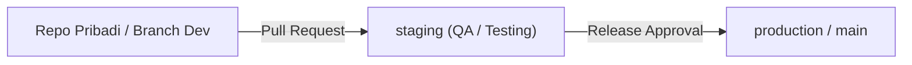

# Sistem Manajemen Aset & Inventaris SMP PGRI 7 Bandung — Backend (API)

Repository **Backend (REST API)** untuk Sistem Informasi Pengelolaan Aset & Sarana Prasarana (**SMP PGRI 7 Bandung** — *Jl. Kencanawangi Utara No. 20a, Bandung 40257*).

> **Visi Arsitektur (Single Portal):**  
> Aplikasi ini dirancang agar ke depannya dapat diintegrasikan ke dalam **Single Portal** pasca-login bersama **Aplikasi Keuangan** yang telah dikembangkan sebelumnya. Pada tahap saat ini, fokus pengembangan adalah menyelesaikan modul **Manajemen Peran** dan **Aplikasi Manajemen Tata Kelola Aset** secara mandiri.

## Tech Stack
- **Framework:** NestJS (Node.js / TypeScript)
- **DBMS:** PostgreSQL (Relational Database)
- **ORM:** Prisma / TypeORM
- **Autentikasi & Otorisasi:** JWT + Role-Based Access Control (RBAC)
- **Repository Terkait:** [Frontend (Next.js PWA)](https://github.com/satriavilly/asset-management-fe-pgri7)

---

## Standar & Konvensi Database (WAJIB)

Berdasarkan kesepakatan teknis proyek:
1. **Bahasa & Format Penamaan (`snake_case`):**
   - Seluruh nama tabel dan kolom **wajib menggunakan Bahasa Inggris**.
   - Format penulisan wajib menggunakan **huruf kecil semua (`lowercase`)** dengan pemisah **garis bawah (`snake_case` / underscore)** — contoh: `master_items`, `funding_sources`, `inventory_code`, `procurement_date`.
2. **Primary Key (`UUID`):**
   - Setiap tabel **wajib menggunakan `UUID`** sebagai *Primary Key* (`id UUID PRIMARY KEY`).
   - **Kode Inventaris Barang (`inventory_code`) DILARANG dijadikan Primary Key** agar proses *indexing* dan pencarian data tetap cepat di masa mendatang (tetap disimpan pada kolom terpisah dengan *unique/btree index*).
3. **Relasi Master Barang vs Transaksi Pengadaan:**
   - **Entitas Master Data Utama:**
     1. **Master Barang (`items`):** Menyimpan atribut yang melekat langsung pada barang, termasuk **Merek (`brand`)** dan **Satuan (`unit`)**.
     2. **Master Kategori & Sub-Kategori (`categories`, `sub_categories`):** Klasifikasi kode `A` s.d. `G` (contoh: `A` Tanah & Bangunan, `A-01` Tanah, `A-02` Bangunan).
     3. **Master Ruangan (`rooms`)**
     4. **Master Sumber Dana / Perolehan (`funding_sources`):** Swadaya (dana mandiri sekolah), Bantuan Pemerintah (`RMP`, `BOS`), dan Bantuan Kondisional/Hibah.
   - **Entitas Transaksi Pengadaan (`procurements`):** Atribut **Harga Perolehan (`acquisition_price`)**, **Tanggal Pengadaan (`procurement_date`)**, dan **Jumlah (`quantity`)** menempel pada tabel transaksi pengadaan, bukan pada tabel master barang.

---

## Peran Pengguna & Hak Akses (RBAC)

- Pengelolaan operasional sarana & prasarana terpusat pada **Wakasek Bidang Sarana dan Prasarana (`SARPRAS`)**.
- Peran **Kepala Sekolah (`KEPSEK`)** difokuskan murni untuk **Monitoring (*Read-Only*)** tanpa beban aksi *approval* di aplikasi.

| Peran | Antarmuka Client | Hak Akses Utama pada Sistem |
| :--- | :--- | :--- |
| **Admin** | Web (Desktop) | Manajemen akun & peran (CRUD User & Role), konfigurasi master data, dan pemantauan *audit log*. |
| **Wakasek Sarpras (`Sarpras`)** | Mobile (PWA) / Web | **Pengguna Utama Operasional:** input pengajuan/pengadaan terpusat, inventarisasi bantuan pemerintah/hibah, cetak stiker label aset (`10 cm x 5 cm`), verifikasi peminjaman (internal/eksternal), tindak lanjut kerusakan & pemeliharaan, *stock opname*, input manual nilai penyusutan, serta pencatatan penghapusan aset (Berita Acara & saksi pemusnahan). |
| **Kepala Sekolah (`Kepsek`)** | Mobile (PWA) | **Monitoring (*Read-Only*):** melihat *dashboard* ringkasan aset, memantau kondisi & nilai aset, serta mengunduh laporan inventaris. |
| **Guru / PJ Ruangan** | Mobile (PWA) | Mengajukan peminjaman aset, mengajukan mutasi ruangan, melaporkan kerusakan aset (via *scan* QR & foto), dan melihat Daftar Inventaris Ruangan (DIR). |
| **Eksternal / Publik** | Mobile (PWA) | Mengajukan peminjaman aset pihak luar (misal: pengurus RT setempat) dan melihat informasi dasar aset saat *scan* QR Code publik. |

---

## Cakupan 7 Modul Fungsionalitas Utama

1. **Pengguna dan Peran (*User & Role Management*):**
   - Fungsi dasar CRUD pengguna, autentikasi (JWT), dan otorisasi berbasis peran (RBAC) yang siap diintegrasikan ke *Single Portal*.
2. **Pengadaan & Inventarisasi Aset:**
   - **Sumber Perolehan:** Swadaya Sekolah, Bantuan Pemerintah (`RMP`, `BOS`), dan Bantuan Kondisional/Hibah (misal: hibah IFP/monitor layar besar, pemberian instansi).
   - **Dua Jalur Pengadaan:**
     1. *Bantuan Pemerintah / Hibah:* Barang datang langsung dicatat/diinventarisasi ke dalam sistem.
     2. *Pengajuan Internal Terpusat:* Wakasek Sarpras mengoleksi kebutuhan dari guru/staf, kemudian Wakasek Sarpras sendiri yang menginput pengajuan dan memprosesnya di sistem.
   - **Auto-Generator Kode Inventaris:** Pola `[Kategori].[SubKategori].[NoUrut].PGRI7.[Tahun]` (contoh: `C.20.042.PGRI7.2025` atau `A-01-xxx`).
3. **Cetak Stiker Label Aset (*Print Out*):**
   - Endpoint & fitur pada Master Barang/Aset untuk mencetak stiker label aset yang baru datang.
   - Memuat **Kode Inventaris Barang**, **QR Code**, dan **Logo Sekolah (SMP PGRI 7 Bandung)** dengan ukuran standar estimasi **10 cm x 5 cm**.
4. **Peminjaman Aset (*Transaksi*):**
   - Mencatat transaksi peminjaman aset sekolah baik oleh **pihak internal** (guru/staf) maupun **pihak eksternal** (misal: pengurus RT setempat) yang berdampak langsung pada status ketersediaan aset (`available` / `borrowed`), lengkap dengan pengecekan bentrok jadwal dan catatan sanksi/denda saat pengembalian.
5. **Kerusakan dan Pemeliharaan:**
   - Mencatat laporan kerusakan aset (disertai foto), riwayat perbaikan mandiri maupun vendor servis luar, serta jadwal pemeliharaan berkala.
6. **Penyusutan Nilai & Penghapusan Aset (*Valuation & Disposal*):**
   - **Penyusutan Nilai Manual (Tanpa Rumus Otomatis):** Perubahan/penyusutan nilai aset diinput secara **manual** oleh pihak sekolah berdasarkan kondisi aktual barang (contoh: harga awal `Rp1.000.000`, saat rusak/turun kondisi dicatat manual menjadi `Rp750.000`).
   - **Penghapusan Aset:** Pencatatan penghapusan/pemusnahan aset wajib menyertakan **Berita Acara Penghapusan** dan **Daftar Saksi Pemusnahan Aset** sesuai standar tata kelola aset pemerintah, lalu diarsipkan (*soft-delete*).
   - **Stock Opname / Audit Fisik Berkala:** Pengecekan kecocokan fisik aset di ruangan via *scan* QR Code dan laporan selisih.
7. **Laporan dan Dashboard:**
   - Menampilkan ringkasan metrik aset pada *dashboard* serta menghasilkan laporan Buku Induk Inventaris dan Daftar Inventaris Ruangan (DIR/KIR) dalam format **Excel (`.xlsx`)** dan **PDF**.

### Batasan Ruang Lingkup (Fitur yang Ditiadakan Saat Ini)
- **Pengajuan pengadaan mandiri oleh akun masing-masing guru/unit** (tetap terpusat melalui Wakasek Sarpras).
- **Integrasi langsung dengan sistem anggaran/RKAS sekolah.**
- **Notifikasi eksternal via WhatsApp** (karena kendala biaya langganan API) maupun **Email**.

---

## Referensi Klasifikasi Kode Barang (Buku Induk SMP PGRI 7 Bandung)

| Kode | Kategori Utama | Sub-Kategori (Kode Jenis) |
| :---: | :--- | :--- |
| **A** | Tanah dan Bangunan | `01` Tanah, `02` Bangunan, `03` Lain-lain |
| **B** | Meubelair (Mebel) | `01` Meja Siswa, `02` Kursi Siswa, `03` Meja Guru, `04` Kursi Guru, `05` Kursi Stainless, `06` Kursi Meeting, `07` Kursi Lipat, `08` Kursi Plastik, `09` Lemari, `10` File Kabinet, `11` Loker, `12` Brankas, `13` Bufet, `14` Papan Tulis, `15` Meja Rapat, `16` Mading, `17` Lain-lain |
| **C** | Elektronik | `01` Komputer, `02` Laptop, `03` Printer, `04` Scanner, `05` Radio, `06` Proyektor, `07` Kamera Foto, `08` Handycam, `09` Televisi, `10` Speaker, `11` Amplifier, `12` Telpon/HP, `13` UPS/Stabilizer, `14` CCTV, `15` AC, `16` Dispenser, `17` Megaphone, `18` Kipas Angin, `19` Mesin Fotocopy, `20` Lain-lain |
| **D** | Mekanik | `01` Bor, `02` Lain-lain |
| **E** | Alat Rumah Tangga | `01` Tangga, `02` Kompor Gas, `03` Tabung Gas, `04` Alat Makan Minum, `05` Alat Pertukangan, `06` Alat Kebersihan, `07` Lain-lain |
| **F** | Pendukung KBM | `01` Pramuka/Paskibra, `02` Alat Seni, `03` Alat Musik, `04` Alat UKS, `05` Alat Olahraga, `06` Buku Perpustakaan, `07` Alat Peraga Matematika, `08` Alat Peraga IPA, `09` Alat Peraga IPS, `10` Lain-lain |
| **G** | ATK (Habis Pakai) | `01` Kertas A4, `02` Kertas F4, `03` Pulpen, `04` Pensil, `05` Spidol, `06` Penghapus Papan Tulis, `07` Tinta Printer, `08` Bak Stempel, `09` Isi Hekter, `10` Lakban Bening, `11` Lakban Hitam, `12` Kertas Jilid, `13` Amplop, `14` Map, `15` Tinta Spidol, `16` Double Tape, `17` Lain-lain |

---

## Alur Kerja Git (Git Workflow)



---

## Panduan Menjalankan Proyek (Local Development)

```bash
# 1. Instal dependensi
npm install

# 2. Salin konfigurasi environment dan sesuaikan kredensial PostgreSQL
cp .env.example .env

# 3. Jalankan migrasi database & seeder master data
npx prisma migrate dev
npx prisma db seed

# 4. Jalankan server dalam mode watch (development)
npm run start:dev
```

