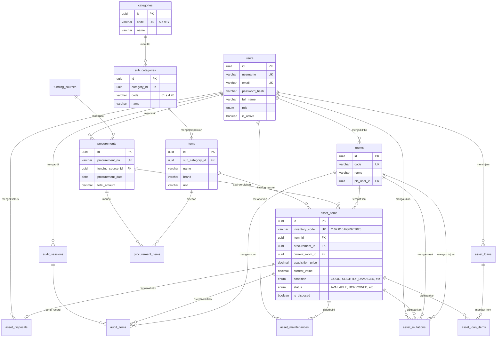
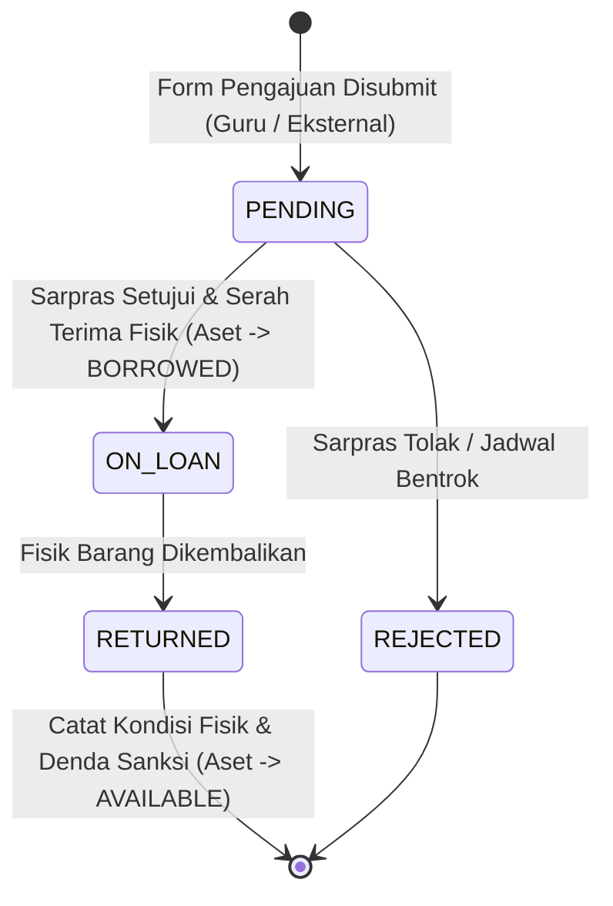
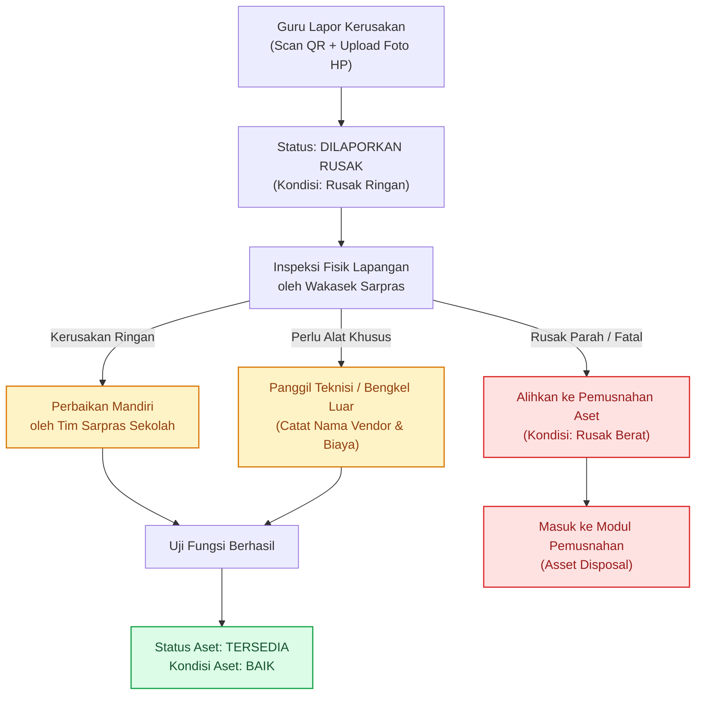
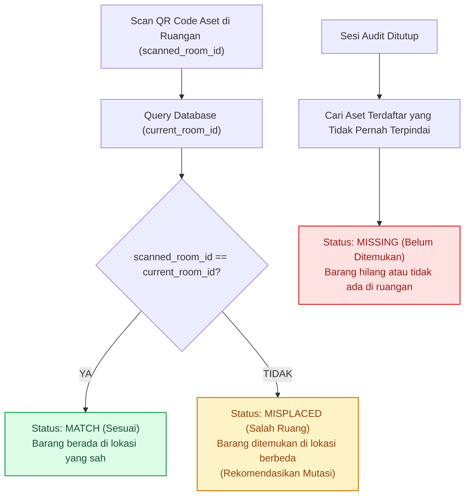
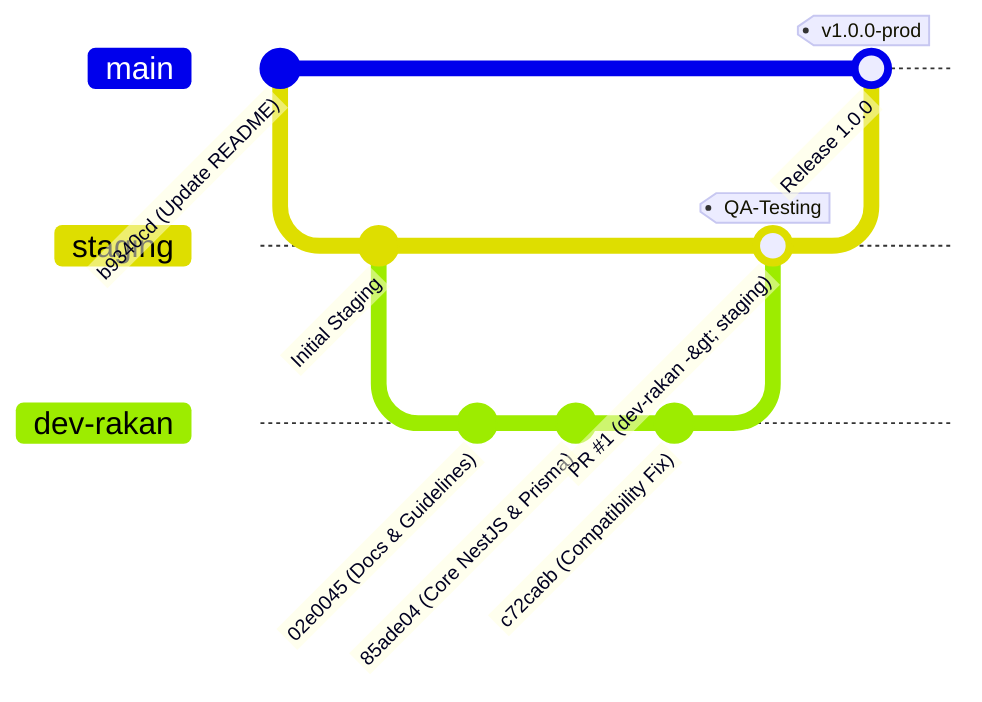

# Sistem Informasi Manajemen Aset SMP PGRI 7 Bandung — Arsitektur & Alur Sistem

Dokumen ini menyajikan pemetaan arsitektur perangkat lunak, skema relasi database relasional, mesin alur bisnis (*state machines*), dan strategi kolaborasi Git yang telah diimplementasikan pada repositori Backend REST API (`asset-management-be-pgri7`).

---

## 🏛️ Arsitektur Aplikasi & Komposisi Modul (NestJS)

Arsitektur backend dibangun dengan pola modular NestJS yang memisahkan tanggung jawab (*separation of concerns*) antara lapisan HTTP Controller, Business Logic Service, Data Access (Prisma ORM), dan Middleware Keamanan (Guards, Interceptors, Filters).

```mermaid
flowchart TD
    accTitle: Arsitektur Modular Backend NestJS
    accDescr: Diagram blok struktur aplikasi backend NestJS yang menghubungkan lapisan client HTTP ke modul bisnis dan database PostgreSQL melalui Prisma ORM.

    subgraph CLIENT["🌐 Client Applications"]
        FE_ADMIN["Web Desktop (Admin TU)"]
        FE_SARPRAS["Mobile PWA (Sarpras)"]
        FE_KEPSEK["Mobile PWA (Kepsek - Read Only)"]
        FE_GURU["Mobile PWA (Guru / PJ Ruangan)"]
    end

    subgraph GATEWAY["🛡️ Security & Interceptor Layer"]
        GLOBAL_FILTER["GlobalHttpExceptionFilter"]
        GLOBAL_INTERCEPT["TransformResponseInterceptor<br/>{ success, data, message, timestamp }"]
        JWT_GUARD["JwtAuthGuard (Passport JWT)"]
        ROLES_GUARD["RolesGuard (RBAC 5 Peran)"]
    end

    subgraph MODULES["📦 Core Business Modules"]
        M_AUTH["AuthModule<br/>(Login, JWT, Bcrypt)"]
        M_USERS["UsersModule<br/>(User Management)"]
        M_MASTER["MasterModule<br/>(Kategori A-G, Items, Rooms, Dana)"]
        M_PROC["ProcurementsModule<br/>(Auto Code & QR Generator)"]
        M_ASSETS["AssetsModule<br/>(Valuasi Manual, Label 10x5 cm)"]
        M_LOANS["LoansModule<br/>(Cek Bentrok Jadwal, Denda)"]
        M_MUT["MutationsModule<br/>(Mutasi Antar Ruang & BAST)"]
        M_MAINT["MaintenancesModule<br/>(Triase: Self / Vendor / Hapus)"]
        M_AUDIT["AuditsModule<br/>(Stock Opname & Rekonsiliasi)"]
        M_DISP["DisposalsModule<br/>(BAST Hapus & 2 Saksi)"]
        M_REP["ReportsModule<br/>(Eksekutif Dashboard & ExcelJS)"]
    end

    subgraph DATA_LAYER["🗄️ Persistence Layer"]
        PRISMA["PrismaModule / PrismaClient<br/>(Global Connection Pooling)"]
        POSTGRES[("PostgreSQL 16 Database<br/>(UUID PKs, snake_case)")]
    end

    CLIENT -->|HTTPS JSON Request| GATEWAY
    GATEWAY --> MODULES
    MODULES --> PRISMA
    PRISMA --> POSTGRES

    classDef clientStyle fill:#e0f2fe,stroke:#0284c7,stroke-width:2px,color:#0369a1
    classDef gateStyle fill:#fef3c7,stroke:#d97706,stroke-width:2px,color:#92400e
    classDef modStyle fill:#f1f5f9,stroke:#475569,stroke-width:1.5px,color:#0f172a
    classDef dbStyle fill:#dcfce7,stroke:#16a34a,stroke-width:2px,color:#14532d

    class FE_ADMIN,FE_SARPRAS,FE_KEPSEK,FE_GURU clientStyle
    class GLOBAL_FILTER,GLOBAL_INTERCEPT,JWT_GUARD,ROLES_GUARD gateStyle
    class M_AUTH,M_USERS,M_MASTER,M_PROC,M_ASSETS,M_LOANS,M_MUT,M_MAINT,M_AUDIT,M_DISP,M_REP modStyle
    class PRISMA,POSTGRES dbStyle
```



---

## 🗄️ Diagram Relasi Entitas Database (Entity Relationship Diagram)

Skema database PostgreSQL mematuhi konvensi baku: seluruh Primary Key bertipe `UUID`, kode inventaris bukan PK, dan penamaan tabel/kolom konsisten menggunakan `lowercase snake_case`.



---

## ⚙️ Logika Algoritma Auto-Generator Kode Inventaris

Formula: `[Kategori].[SubKategori].[NoUrut].PGRI7.[Tahun]` *(Contoh: `C.02.010.PGRI7.2025`)*

```mermaid
sequenceDiagram
    accTitle: Alur Eksekusi Auto Generator Kode Inventaris
    accDescr: Diagram sequence interaksi sistem saat transaksi pengadaan baru diinput oleh Sarpras hingga fisik aset dan QR Code terbuat otomatis.

    autonumber
    actor Sarpras as Wakasek Sarpras
    participant Controller as ProcurementsController
    participant Service as ProcurementsService
    participant DB as PostgreSQL (Transaction)
    participant QR as QRCode Engine

    Sarpras->>Controller: POST /api/v1/procurements (item_id, qty=10, harga, ruangan)
    Controller->>Service: createProcurement(dto, userId)
    Service->>DB: BEGIN TRANSACTION
    Service->>DB: INSERT INTO procurements (faktur, dana, tanggal, total)
    Service->>DB: INSERT INTO procurement_items (qty, unit_price, total_price)
    
    loop Setiap Unit Barang (1 s.d 10)
        Service->>DB: SELECT inventory_code FROM asset_items WHERE code LIKE 'C.02.%.PGRI7.2025' ORDER BY code DESC LIMIT 1
        DB-->>Service: 'C.02.009.PGRI7.2025' (sequence terakhir = 9)
        Service->>Service: Hitung sequence baru: 9 + 1 = 10 -> padStart(3, '0') -> '010'
        Service->>Service: Susun kode: 'C.02.010.PGRI7.2025'
        Service->>QR: Generate payload JSON & Base64 Data URL
        QR-->>Service: data:image/png;base64,...
        Service->>DB: INSERT INTO asset_items (inventory_code, item_id, room_id, acquisition_price, currentValue, status=AVAILABLE, qr_code_url)
    end
    
    Service->>DB: COMMIT TRANSACTION
    DB-->>Controller: Transaksi & 10 Aset Selesai Dibuat
    Controller-->>Sarpras: HTTP 201 Created (procurement, list kode, status sukses)
```

---

## 🔄 Mesin Status & Alur Transaksi Utama (State Machines)

### 1. Peminjaman Aset & Deteksi Bentrok Jadwal
Peminjaman memvalidasi rentang tanggal agar tidak terjadi bentrok pemakaian aset di hari yang sama.



### 2. Triase Kerusakan & Siklus Pemeliharaan
Laporan kerusakan diverifikasi langsung di lapangan oleh Wakasek Sarpras dengan 3 opsi penanganan:



### 3. Rekonsiliasi Stock Opname Fisik vs Sistem
Algoritma pengecekan kecocokan aset saat auditor keliling ruangan memindai QR Code via smartphone:



---

## 🌿 Alur Kolaborasi Git & Siklus Rilis (Branching Strategy)

Pengembangan mematuhi alur resmi: kode fitur dikerjakan di branch personal (`dev-rakan`), diajukan melalui Pull Request ke `staging` untuk pengujian QA, sebelum digabung ke `main` untuk rilis.


