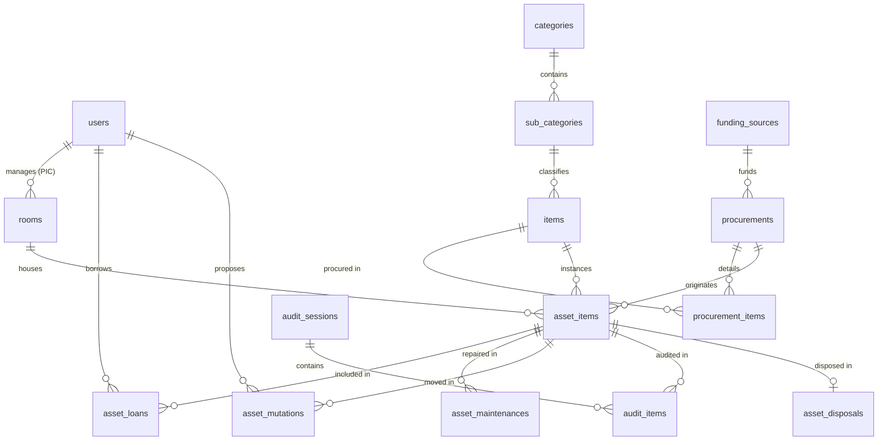

# DATABASE DESIGN & SCHEMA SPECIFICATION
# Project: Sistem Informasi Manajemen Aset SMP PGRI 7 Bandung
# DBMS: PostgreSQL 15+ / 16+ | ORM: Prisma

---

## 1. Konvensi & Standar Mutlak
1. **Primary Key Wajib `UUID`**: Semua tabel memiliki kolom `id UUID PRIMARY KEY DEFAULT gen_random_uuid()`.
2. **Naming Case**: Semua nama tabel dan nama kolom menggunakan huruf kecil bergaris bawah (`lowercase snake_case`) dalam **Bahasa Inggris**.
3. **Kolom Kode Inventaris**: Kolom `inventory_code` bertipe `VARCHAR(50)`, bukan Primary Key, dan dipasangi indeks `UNIQUE`.
4. **Pemisahan Master vs Transaksi**: 
   - Tabel `items` (master data) menyimpan merek (`brand`) dan satuan (`unit`).
   - Tabel `procurements` dan `procurement_items` (transaksi) menyimpan harga beli (`unit_price`), tanggal pengadaan, dan kuantitas.
5. **Soft Delete / Preservation**: Aset yang dihapus/dimusnahkan tidak di-hard delete dari database agar rekam jejak Buku Induk Inventaris tetap konsisten. Menggunakan flag `is_disposed` dan tabel relasi `asset_disposals`.

---

## 2. Diagram Relasi Entitas (Entity Relationship)

---

## 3. Kamus Data & Rincian Tabel

### A. Tabel Manajemen Pengguna & Autentikasi
#### `users`
| Kolom | Tipe Data | Constraint | Keterangan |
|---|---|---|---|
| `id` | `UUID` | PK, Default `gen_random_uuid()` | ID unik pengguna |
| `username` | `VARCHAR(50)` | UNIQUE, NOT NULL | Username login (huruf/angka) |
| `email` | `VARCHAR(100)` | UNIQUE, NOT NULL | Alamat email terdaftar |
| `password_hash` | `VARCHAR(255)` | NOT NULL | Hash kata sandi (Argon2id / Bcrypt) |
| `full_name` | `VARCHAR(100)` | NOT NULL | Nama lengkap personil |
| `nip_nuptk` | `VARCHAR(50)` | NULL | NIP atau NUPTK guru/staf |
| `phone_number` | `VARCHAR(25)` | NULL | Nomor telepon / HP aktif |
| `role` | `user_role_enum` | NOT NULL | `ADMIN`, `SARPRAS`, `KEPSEK`, `GURU`, `EKSTERNAL` |
| `is_active` | `BOOLEAN` | Default `TRUE` | Status keaktifan akun |
| `created_at` | `TIMESTAMPTZ` | Default `NOW()` | Waktu registrasi |
| `updated_at` | `TIMESTAMPTZ` | Auto update | Waktu pembaruan data |

---

### B. Tabel Master Data

#### `categories` (Klasifikasi A - G)
| Kolom | Tipe Data | Constraint | Keterangan |
|---|---|---|---|
| `id` | `UUID` | PK, Default `gen_random_uuid()` | ID unik kategori |
| `code` | `VARCHAR(5)` | UNIQUE, NOT NULL | Kode huruf kategori (`A`, `B`, `C`, `D`, `E`, `F`, `G`) |
| `name` | `VARCHAR(100)` | NOT NULL | Nama kategori (contoh: `Elektronik`) |
| `description` | `TEXT` | NULL | Catatan cakupan barang |
| `created_at` | `TIMESTAMPTZ` | Default `NOW()` | Timestamp pembuatan |

#### `sub_categories` (Kode Jenis 01 - 20)
| Kolom | Tipe Data | Constraint | Keterangan |
|---|---|---|---|
| `id` | `UUID` | PK, Default `gen_random_uuid()` | ID unik sub-kategori |
| `category_id` | `UUID` | FK -> `categories.id` | Induk kategori utama |
| `code` | `VARCHAR(5)` | NOT NULL | Kode jenis (contoh: `01`, `02`, `20`) |
| `name` | `VARCHAR(100)` | NOT NULL | Nama sub-jenis (contoh: `Laptop`) |
| `description` | `TEXT` | NULL | Keterangan sub-kategori |
| `created_at` | `TIMESTAMPTZ` | Default `NOW()` | Timestamp pembuatan |
*Unique constraint:* `(category_id, code)`

#### `items` (Katalog Master Barang)
| Kolom | Tipe Data | Constraint | Keterangan |
|---|---|---|---|
| `id` | `UUID` | PK, Default `gen_random_uuid()` | ID unik master barang |
| `sub_category_id`| `UUID` | FK -> `sub_categories.id` | Sub-kategori klasifikasi |
| `name` | `VARCHAR(150)` | NOT NULL | Nama barang (contoh: `Laptop ThinkPad V14`) |
| `brand` | `VARCHAR(100)` | NOT NULL | Merek barang (contoh: `Lenovo`, `Maspion`) |
| `unit` | `VARCHAR(50)` | NOT NULL | Satuan barang (`unit`, `buah`, `set`, `rim`) |
| `specifications` | `TEXT` | NULL | Spesifikasi teknis (RAM, dimensi, prosesor) |
| `created_at` | `TIMESTAMPTZ` | Default `NOW()` | Timestamp |

#### `rooms` (Master Ruangan & Lokasi)
| Kolom | Tipe Data | Constraint | Keterangan |
|---|---|---|---|
| `id` | `UUID` | PK, Default `gen_random_uuid()` | ID unik ruangan |
| `code` | `VARCHAR(20)` | UNIQUE, NOT NULL | Kode ruangan (contoh: `LAB-KOMP-1`, `R-GURU`) |
| `name` | `VARCHAR(100)` | NOT NULL | Nama ruangan |
| `building_name`| `VARCHAR(100)` | NULL | Nama gedung/blok |
| `floor` | `INTEGER` | Default `1` | Posisi lantai |
| `pic_user_id` | `UUID` | FK -> `users.id` (NULL) | Penanggung Jawab Ruangan (Guru) |
| `created_at` | `TIMESTAMPTZ` | Default `NOW()` | Timestamp |

#### `funding_sources` (Sumber Anggaran / Perolehan)
| Kolom | Tipe Data | Constraint | Keterangan |
|---|---|---|---|
| `id` | `UUID` | PK, Default `gen_random_uuid()` | ID unik sumber dana |
| `code` | `VARCHAR(20)` | UNIQUE, NOT NULL | `SWADAYA`, `RMP`, `BOS`, `HIBAH` |
| `name` | `VARCHAR(100)` | NOT NULL | Label sumber dana |
| `description` | `TEXT` | NULL | Keterangan peruntukan |

---

### C. Tabel Transaksi Pengadaan & Fisik Aset

#### `procurements` (Transaksi Induk Pengadaan)
| Kolom | Tipe Data | Constraint | Keterangan |
|---|---|---|---|
| `id` | `UUID` | PK, Default `gen_random_uuid()` | ID transaksi pengadaan |
| `procurement_no`| `VARCHAR(50)` | UNIQUE, NOT NULL | Nomor referensi/faktur internal |
| `funding_source_id`| `UUID` | FK -> `funding_sources.id` | Sumber perolehan dana |
| `procurement_date`| `DATE` | NOT NULL | Tanggal realisasi pembelian/hibah |
| `receipt_bast_no`| `VARCHAR(100)` | NULL | Nomor BAST Serah Terima fisik |
| `total_amount` | `NUMERIC(15,2)` | Default `0` | Total biaya seluruh item |
| `created_by` | `UUID` | FK -> `users.id` (Sarpras) | User penginput data |
| `created_at` | `TIMESTAMPTZ` | Default `NOW()` | Timestamp |

#### `procurement_items` (Rincian Item Pengadaan)
| Kolom | Tipe Data | Constraint | Keterangan |
|---|---|---|---|
| `id` | `UUID` | PK, Default `gen_random_uuid()` | ID rincian item |
| `procurement_id`| `UUID` | FK -> `procurements.id` | Induk transaksi pengadaan |
| `item_id` | `UUID` | FK -> `items.id` | Master barang yang dibeli |
| `quantity` | `INTEGER` | NOT NULL | Kuantitas unit barang |
| `unit_price` | `NUMERIC(15,2)` | NOT NULL | Harga perolehan per satuan unit |
| `total_price` | `NUMERIC(15,2)` | NOT NULL | `quantity * unit_price` |

#### `asset_items` (Entitas Fisik Riil Aset)
| Kolom | Tipe Data | Constraint | Keterangan |
|---|---|---|---|
| `id` | `UUID` | PK, Default `gen_random_uuid()` | ID unik fisik aset |
| `inventory_code`| `VARCHAR(50)` | UNIQUE, INDEX, NOT NULL | Format: `C.02.010.PGRI7.2025` |
| `item_id` | `UUID` | FK -> `items.id` | Mengacu ke katalog barang |
| `procurement_id`| `UUID` | FK -> `procurements.id` | Mengacu ke histori pembelian |
| `current_room_id`| `UUID` | FK -> `rooms.id` | Lokasi penempatan terkini |
| `serial_number` | `VARCHAR(100)` | NULL | Nomor seri pabrikan |
| `acquisition_price`| `NUMERIC(15,2)`| NOT NULL | Nilai saat perolehan awal |
| `current_value` | `NUMERIC(15,2)`| NOT NULL | Nilai aktual terkini (diinput manual) |
| `condition` | `asset_condition_enum` | NOT NULL | `GOOD`, `SLIGHTLY_DAMAGED`, `HEAVILY_DAMAGED`, `LOST` |
| `status` | `asset_status_enum` | NOT NULL | `AVAILABLE`, `BORROWED`, `UNDER_MAINTENANCE`, `DISPOSED` |
| `qr_code_url` | `TEXT` | NULL | Path URL file image QR Code |
| `photo_url` | `TEXT` | NULL | Foto fisik barang |
| `is_disposed` | `BOOLEAN` | Default `FALSE` | Flag soft-delete jika dimusnahkan |
| `created_at` | `TIMESTAMPTZ` | Default `NOW()` | Tanggal registrasi buku induk |
| `updated_at` | `TIMESTAMPTZ` | Auto update | Timestamp |

---

### D. Tabel Peminjaman, Mutasi, Pemeliharaan, Audit, & Penghapusan

#### `asset_loans` (Transaksi Peminjaman)
| Kolom | Tipe Data | Constraint | Keterangan |
|---|---|---|---|
| `id` | `UUID` | PK, Default `gen_random_uuid()` | ID peminjaman |
| `loan_no` | `VARCHAR(50)` | UNIQUE, NOT NULL | Nomor transaksi surat peminjaman |
| `borrower_type` | `borrower_type_enum` | NOT NULL | `INTERNAL` (Guru/Staf), `EXTERNAL` (RT/Masyarakat) |
| `borrower_user_id`| `UUID` | FK -> `users.id` (NULL) | Akun jika internal |
| `borrower_name` | `VARCHAR(100)` | NOT NULL | Nama lengkap peminjam |
| `borrower_phone`| `VARCHAR(25)` | NOT NULL | No HP / WhatsApp peminjam |
| `borrower_id_card`| `VARCHAR(50)` | NULL | NIK / KTP jika pihak luar |
| `start_date` | `DATE` | NOT NULL | Rencana tanggal mulai pinjam |
| `expected_return_date`| `DATE` | NOT NULL | Rencana tanggal kembali |
| `actual_return_date`| `DATE` | NULL | Realisasi tanggal pengembalian fisik |
| `purpose` | `TEXT` | NOT NULL | Keperluan peminjaman |
| `status` | `loan_status_enum` | NOT NULL | `PENDING`, `APPROVED`, `REJECTED`, `ON_LOAN`, `RETURNED` |
| `penalty_notes` | `TEXT` | NULL | Catatan sanksi/ganti rugi jika rusak/hilang |
| `approved_by` | `UUID` | FK -> `users.id` (Sarpras) | User yang memverifikasi |
| `created_at` | `TIMESTAMPTZ` | Default `NOW()` | Timestamp |

#### `asset_loan_items`
| Kolom | Tipe Data | Constraint | Keterangan |
|---|---|---|---|
| `id` | `UUID` | PK, Default `gen_random_uuid()` | ID relasi item pinjam |
| `loan_id` | `UUID` | FK -> `asset_loans.id` | Induk peminjaman |
| `asset_item_id` | `UUID` | FK -> `asset_items.id` | Fisik barang yang dipinjam |
| `condition_before`| `asset_condition_enum`| NOT NULL | Kondisi saat diserahkan |
| `condition_after` | `asset_condition_enum`| NULL | Kondisi saat dikembalikan |

#### `asset_mutations` (Pemindahan Antar Ruangan)
| Kolom | Tipe Data | Constraint | Keterangan |
|---|---|---|---|
| `id` | `UUID` | PK, Default `gen_random_uuid()` | ID mutasi aset |
| `mutation_no` | `VARCHAR(50)` | UNIQUE, NOT NULL | Nomor Berita Acara Mutasi |
| `asset_item_id` | `UUID` | FK -> `asset_items.id` | Aset yang dipindahkan |
| `from_room_id` | `UUID` | FK -> `rooms.id` | Ruangan asal |
| `to_room_id` | `UUID` | FK -> `rooms.id` | Ruangan tujuan |
| `proposed_by` | `UUID` | FK -> `users.id` (PJ Ruangan) | Pengaju permohonan |
| `reason` | `TEXT` | NOT NULL | Alasan mutasi fisik |
| `status` | `mutation_status_enum`| NOT NULL | `PENDING`, `APPROVED`, `REJECTED`, `COMPLETED` |
| `bast_document_url`| `TEXT` | NULL | Path berkas BAST Mutasi (PDF) |
| `approved_by` | `UUID` | FK -> `users.id` (Sarpras) | Persetujuan Sarpras |
| `executed_at` | `TIMESTAMPTZ` | NULL | Waktu pemindahan selesai |

#### `asset_maintenances` (Pelaporan Kerusakan & Servis)
| Kolom | Tipe Data | Constraint | Keterangan |
|---|---|---|---|
| `id` | `UUID` | PK, Default `gen_random_uuid()` | ID pemeliharaan |
| `asset_item_id` | `UUID` | FK -> `asset_items.id` | Aset yang rusak |
| `reported_by` | `UUID` | FK -> `users.id` (Guru/Staf) | Pelapor kerusakan |
| `damage_description`| `TEXT` | NOT NULL | Uraian gejala/kerusakan |
| `damage_photo_url` | `TEXT` | NOT NULL | Foto bukti kerusakan dari HP |
| `maintenance_type` | `maintenance_type_enum`| NULL | `SELF` (Mandiri), `VENDOR` (Pihak Luar) |
| `vendor_name` | `VARCHAR(100)` | NULL | Nama bengkel / teknisi vendor |
| `cost` | `NUMERIC(15,2)`| Default `0` | Realisasi biaya servis |
| `status` | `maintenance_status_enum`| NOT NULL | `REPORTED`, `INSPECTED`, `IN_PROGRESS`, `COMPLETED`, `ESCALATED_DISPOSAL` |
| `completed_at` | `TIMESTAMPTZ` | NULL | Waktu servis tuntas |

#### `audit_sessions` (Sesi Stock Opname)
| Kolom | Tipe Data | Constraint | Keterangan |
|---|---|---|---|
| `id` | `UUID` | PK, Default `gen_random_uuid()` | ID sesi stock opname |
| `session_name` | `VARCHAR(100)` | NOT NULL | Contoh: `Audit Semester Ganjil 2026/2027` |
| `audit_year` | `INTEGER` | NOT NULL | Tahun pelaksanaan |
| `start_date` | `DATE` | NOT NULL | Tanggal mulai audit |
| `end_date` | `DATE` | NULL | Tanggal selesai audit |
| `auditor_id` | `UUID` | FK -> `users.id` (Sarpras) | Pelaksana stock opname |
| `status` | `audit_status_enum` | NOT NULL | `OPEN`, `IN_PROGRESS`, `COMPLETED` |
| `summary_report_url`| `TEXT` | NULL | Dokumen rekap Berita Acara Audit |

#### `audit_items` (Detail Pengecekan Fisik Scan QR)
| Kolom | Tipe Data | Constraint | Keterangan |
|---|---|---|---|
| `id` | `UUID` | PK, Default `gen_random_uuid()` | ID item audit |
| `audit_session_id`| `UUID` | FK -> `audit_sessions.id` | Sesi audit induk |
| `asset_item_id` | `UUID` | FK -> `asset_items.id` | Aset yang di-scan |
| `scanned_room_id`| `UUID` | FK -> `rooms.id` | Ruangan tempat fisik ditemukan |
| `system_room_id` | `UUID` | FK -> `rooms.id` | Ruangan tercatat di database |
| `physical_condition`| `asset_condition_enum`| NOT NULL | Kondisi fisik saat dipegang |
| `match_status` | `audit_match_enum` | NOT NULL | `MATCH`, `MISPLACED` (Beda ruang), `MISSING` (Hilang) |
| `scanned_at` | `TIMESTAMPTZ` | Default `NOW()` | Waktu scan kamera HP |

#### `asset_disposals` (Pemusnahan / Penghapusan Aset)
| Kolom | Tipe Data | Constraint | Keterangan |
|---|---|---|---|
| `id` | `UUID` | PK, Default `gen_random_uuid()` | ID pemusnahan aset |
| `disposal_no` | `VARCHAR(50)` | UNIQUE, NOT NULL | Nomor Berita Acara Pemusnahan |
| `asset_item_id` | `UUID` | FK -> `asset_items.id` | Aset yang dimusnahkan |
| `disposal_date` | `DATE` | NOT NULL | Tanggal eksekusi pemusnahan |
| `disposal_method`| `disposal_method_enum`| NOT NULL | `SCRAP_DESTROY`, `SELL_AUCTION`, `DONATE` |
| `reason` | `disposal_reason_enum`| NOT NULL | `DAMAGED_BEYOND_REPAIR`, `LOST`, `OBSOLETE` |
| `witness_1_name` | `VARCHAR(100)` | NOT NULL | Nama saksi 1 (staf/guru) |
| `witness_1_role` | `VARCHAR(100)` | NOT NULL | Jabatan saksi 1 |
| `witness_2_name` | `VARCHAR(100)` | NOT NULL | Nama saksi 2 (staf/komite) |
| `witness_2_role` | `VARCHAR(100)` | NOT NULL | Jabatan saksi 2 |
| `evidence_doc_url`| `TEXT` | NOT NULL | URL scan dokumen Berita Acara & foto |
| `executed_by` | `UUID` | FK -> `users.id` (Sarpras) | Eksekutor pemusnahan |
| `created_at` | `TIMESTAMPTZ` | Default `NOW()` | Timestamp pengarsipan |
